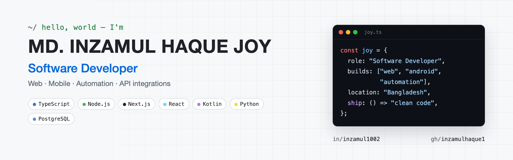
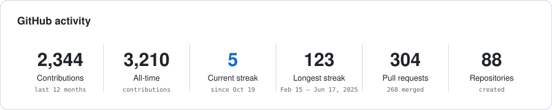
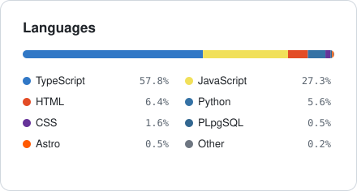
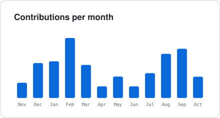

  <picture>
    <source media="(prefers-color-scheme: dark)" srcset="./images/banner-dark.png" />
    
  </picture>

<h1 align="center">
  
</h1>

  I'm a Software Developer working on production web applications, from the UI to the database. Most of my day is TypeScript, Node.js, Next.js, and PostgreSQL, plus API integrations and automation that save people manual work.

---

<h2>👀 Current Overview</h2>

- **Working on:** Production web apps with TypeScript, Node.js, Next.js, and PostgreSQL
- **Building:** Android apps in Kotlin and Jetpack Compose, plus cross-platform games with React Native
- **Automating:** Content and workflow automation with Python
- **Integrating:** Ad platforms, payments, messaging, and AI APIs
- **Learning:** System design, testing, and performance at scale

<h2>🛠️ Technologies I Know</h2>

<table align="center">
  <tr>
    <th>Category</th>
    <th>Technologies</th>
  </tr>
  <tr>
    <td><strong>Frontend</strong></td>
    <td>
      
      
      
      
    </td>
  </tr>
  <tr>
    <td><strong>Mobile</strong></td>
    <td>
      
      
      
      
    </td>
  </tr>
  <tr>
    <td><strong>Backend</strong></td>
    <td>
      
      
      
      
    </td>
  </tr>
  <tr>
    <td><strong>Database</strong></td>
    <td>
      
      
      
      
      
    </td>
  </tr>
  <tr>
    <td><strong>Languages</strong></td>
    <td>
      
      
      
      
    </td>
  </tr>
  <tr>
    <td><strong>AI</strong></td>
    <td>
      
      
      
    </td>
  </tr>
  <tr>
    <td><strong>Tools</strong></td>
    <td>
      
      
      
      
    </td>
  </tr>
</table>

---

<h2 align="center">📊 GitHub Stats</h2>

  <picture>
    <source media="(prefers-color-scheme: dark)" srcset="./profile/stats-dark.svg" />
    
  </picture>

  <picture>
    <source media="(prefers-color-scheme: dark)" srcset="./profile/languages-dark.svg" />
    
  </picture>
  <picture>
    <source media="(prefers-color-scheme: dark)" srcset="./profile/activity-dark.svg" />
    
  </picture>

---

<h2 align="center">📫 Connect With Me</h2>

  
  
  

Thanks for visiting.

  

